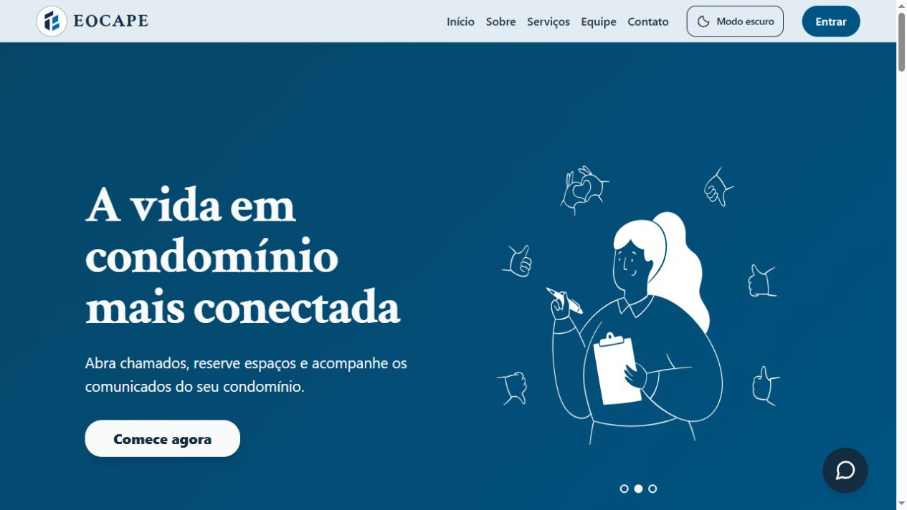
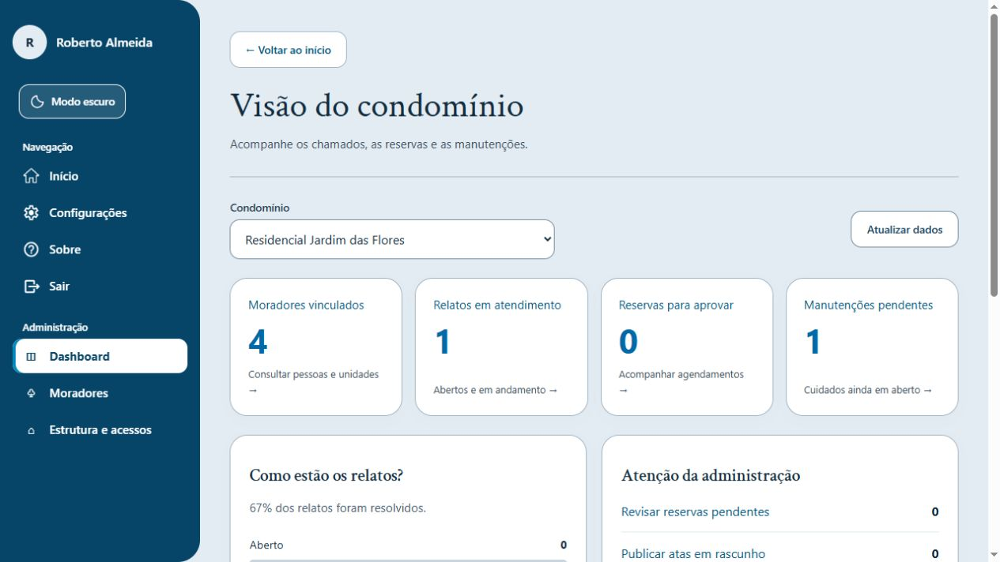
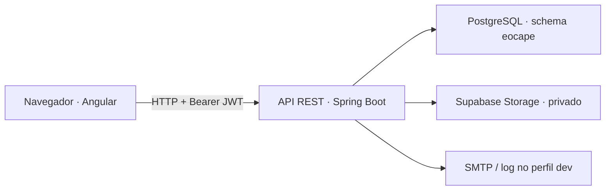
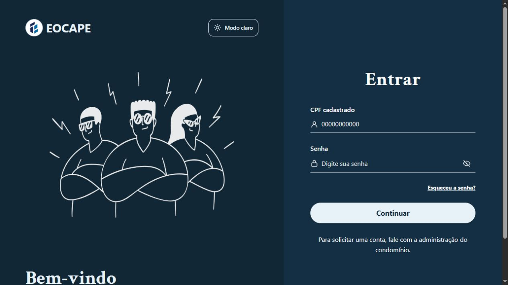
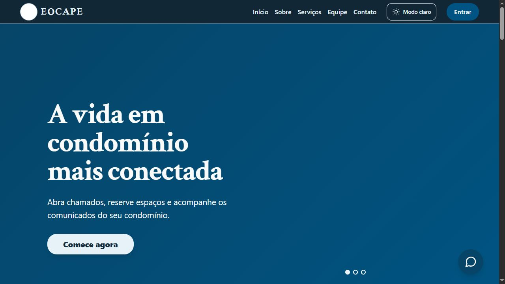
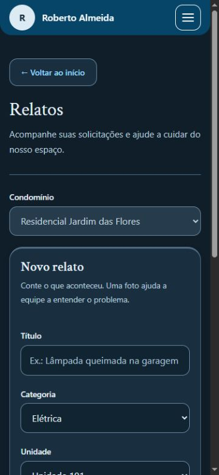

# EOCAPE

**Gestão e convivência em condomínio em uma plataforma web.**

Projeto acadêmico desenvolvido para aproximar moradores, síndicos e administradores. O EOCAPE reúne comunicação, solicitações de manutenção, documentos, reservas e anúncios entre vizinhos, com controle de acesso por condomínio.



## Conteúdo

- [Sobre o projeto](#sobre-o-projeto)
- [Funcionalidades e perfis](#funcionalidades-e-perfis)
- [Tecnologias e arquitetura](#tecnologias-e-arquitetura)
- [Como executar, passo a passo](#como-executar-passo-a-passo)
- [Acesso e contas de demonstração](#acesso-e-contas-de-demonstração)
- [Modo claro e escuro](#modo-claro-e-escuro)
- [Testes e verificações](#testes-e-verificações)
- [Documentação e JavaDoc](#documentação-e-javadoc)
- [Problemas comuns](#problemas-comuns)
- [Limitações e próximos passos](#limitações-e-próximos-passos)

## Sobre o projeto

A proposta é organizar as atividades do condomínio em um portal acessível pelo computador ou celular. O morador acompanha o que acontece em sua comunidade; a administração gerencia pessoas, espaços e atendimentos em um ambiente centralizado.

O site possui duas partes:

1. **Área pública:** apresentação do produto, benefícios, equipe e formulário de contato.
2. **Área autenticada:** serviços do condomínio e telas administrativas disponíveis conforme o papel do usuário.

### Objetivos

- Centralizar avisos e documentos da comunidade.
- Registrar chamados com histórico e anexos, facilitando o acompanhamento.
- Organizar reservas de áreas comuns e sua aprovação.
- Permitir anúncios entre moradores do mesmo condomínio.
- Dar à administração visibilidade das pendências e da estrutura cadastrada.
- Exercitar desenvolvimento web, API REST, persistência, autenticação e testes em um projeto acadêmico.

## Funcionalidades e perfis

| Módulo              | O que está implementado                                                             |
| ------------------- | ----------------------------------------------------------------------------------- |
| Acesso              | Login por CPF, JWT, verificação de e-mail no primeiro acesso e troca de senha       |
| Comunicados         | Consulta, criação, edição, destaque e exclusão conforme a permissão                 |
| Relatos/chamados    | Abertura, consulta, histórico, atualização de status, fotos e anexos                |
| Reservas            | Agendamento de espaços, aprovação e cancelamento conforme as regras do domínio      |
| Atas                | Rascunhos, publicação, consulta e anexos                                            |
| Manutenções         | Registro e consulta de manutenções em unidades ou áreas comuns                      |
| Classificados       | Anúncios de venda, doação e serviço, edição, encerramento e anexos                  |
| Dashboard           | Indicadores e pendências do condomínio selecionado                                  |
| Moradores           | Consulta agrupada por usuário, cadastro com unidade e vínculo de cadastro existente |
| Estrutura e acessos | Blocos, unidades, áreas, espaços comuns e atribuição/revogação de papéis            |
| Preferências        | Modo claro/escuro e preferências locais do navegador                                |

**Sugestões e encomendas são prévias visuais:** não possuem endpoints nem envio à administração nesta versão. As preferências locais de notificação não ativam disparos de e-mail ou push.

### Quem pode acessar

| Perfil                                | Responsabilidades                                                                            |
| ------------------------------------- | -------------------------------------------------------------------------------------------- |
| Morador com vínculo ativo             | Consultar o conteúdo autorizado, abrir chamados, solicitar reservas e anunciar               |
| Síndico/administrador com papel ativo | Gerenciar a estrutura e os moradores, acompanhar pendências e executar ações administrativas |

O acesso é verificado no backend. Ocultar um menu no frontend não substitui a autorização da API. Um papel de gestão em um condomínio não concede gestão nos demais.



## Tecnologias e arquitetura

| Camada       | Tecnologias declaradas no projeto                                                        |
| ------------ | ---------------------------------------------------------------------------------------- |
| Frontend     | Angular 22.2, TypeScript 6, Tailwind CSS 4, RxJS                                         |
| Backend      | Java 25, Spring Boot 4.1.1, Spring Security, Spring Data JPA, Jakarta Validation, Lombok |
| Banco        | PostgreSQL, schema `eocape`                                                              |
| Arquivos     | Supabase Storage, bucket privado e links assinados                                       |
| E-mail       | SMTP no perfil padrão; códigos registrados no log no perfil `dev`                        |
| Testes       | Vitest no frontend; JUnit e Mockito no backend; requisições `.http` para testes manuais  |
| Documentação | JavaDoc padrão do JDK, README e referência dos endpoints                                 |



No desenvolvimento, o navegador acessa o Angular na porta **4200**. O proxy encaminha os caminhos da API para o backend na porta **8080**. As chaves do banco, JWT e Storage ficam exclusivamente no backend.

### Organização das pastas

```text
EOCAPE/
├── backend/
│   ├── src/main/java/com/eocape/backend/  # Módulos da API
│   ├── src/main/resources/               # Propriedades Spring
│   ├── src/test/                         # Testes Java
│   ├── http/                             # Requisições manuais
│   ├── scripts/gerar-javadoc.ps1          # Geração da documentação
│   └── .env.example                      # Modelo de configuração
├── frontend/
│   ├── src/app/pages/                    # Telas e painel administrativo
│   ├── src/app/components/               # Componentes compartilhados
│   ├── src/app/auth/                     # Sessão, interceptor e guards
│   ├── src/app/services/                 # API e preferência de tema
│   ├── src/panel.css                     # Estilo do painel
│   ├── src/themes.css                    # Paleta do modo escuro
│   └── proxy.conf.json                   # Encaminhamento local da API
├── database/eocape.sql                   # Estrutura e dados fictícios
├── docs/                                # Imagens e referência da API
├── JavaDoc/                             # Cópia local da documentação, quando gerada/copida
└── README.md
```

## Como executar, passo a passo

Os exemplos abaixo usam **PowerShell no Windows**. Execute os comandos nas pastas indicadas. O primeiro download das dependências requer conexão com a internet.

### 1. Conferir os pré-requisitos

- **JDK 25 ou superior compatível com as dependências do projeto**, com `java` no PATH. O projeto compila para Java 25.
- **Node.js 24.15 ou superior da linha 24**, recomendado para reproduzir o ambiente. O Angular CLI instalado também aceita Node `^22.22.3` ou `>=26.0.0`.
- **npm**, fornecido com o Node. O `package.json` declara npm 11.17.0.
- **Git**, para obter o repositório.
- Um projeto **Supabase** com acesso ao PostgreSQL e ao Storage.
- Credenciais SMTP para testar o envio real de e-mail; no perfil `dev`, os códigos aparecem no terminal.

```powershell
java -version
node --version
npm --version
git --version
```

Não é necessário instalar o Maven globalmente: `backend/mvnw.cmd` utiliza o Maven Wrapper incluído no projeto.

### 2. Obter o projeto

```powershell
git clone https://github.com/JoaogDi4s/EOCAPE.git
cd EOCAPE
```

Se já possui a pasta, abra-a no editor e continue no próximo passo.

### 3. Preparar o banco de desenvolvimento

1. Crie ou selecione um projeto de desenvolvimento no Supabase.
2. Abra o SQL Editor.
3. Leia e execute [database/eocape.sql](database/eocape.sql) em um banco vazio destinado ao projeto.
4. Confira se o schema **`eocape`** e suas tabelas foram criados.

O arquivo contém **estrutura e dados de demonstração**. Não é uma migração incremental nem um script para ser repetido em um banco já populado. As extensões `pgcrypto` e `btree_gist` são usadas por hashes e restrições de reservas.

O backend usa `spring.jpa.hibernate.ddl-auto=validate`: ele **valida** as tabelas existentes, mas não as cria automaticamente.

Se utiliza uma cópia anterior do schema e a inicialização indicar ausência de `aviso.publicado`, a entidade atual espera esta coluna:

```sql
ALTER TABLE eocape.aviso
  ADD COLUMN IF NOT EXISTS publicado boolean NOT NULL DEFAULT false;
```

Execute ajustes apenas no seu ambiente de desenvolvimento e verifique o erro de validação antes de aplicá-los. O script atual já inclui essa coluna.

### 4. Preparar o armazenamento

No Supabase Storage, crie um bucket **privado** chamado `eocape`, ou escolha outro nome e informe-o em `SUPABASE_BUCKET`.

O SQL de demonstração cadastra metadados de anexos, mas não envia os arquivos físicos ao Storage. Para testar downloads reais, envie um novo arquivo pelo sistema.

### 5. Configurar o backend

Na raiz do projeto:

```powershell
cd backend
Copy-Item .env.example .env
```

Edite `backend/.env` com os dados do seu projeto. Exemplo **sem credenciais reais**:

```dotenv
DB_URL=jdbc:postgresql://SEU_HOST:5432/postgres?sslmode=require
DB_USER=SEU_USUARIO_DO_BANCO
DB_PASSWORD=SUA_SENHA_DO_BANCO

JWT_SECRET=SUBSTITUA_POR_UM_SEGREDO_ALEATORIO_COM_PELO_MENOS_32_BYTES

MAIL_FROM=noreply@eocape.test
MAIL_HOST=localhost
MAIL_PORT=1025
MAIL_USERNAME=preencher_para_smtp_real
MAIL_PASSWORD=preencher_para_smtp_real

SUPABASE_URL=https://SEU_PROJETO.supabase.co
SUPABASE_SERVICE_KEY=SUA_CHAVE_DE_SERVICO
SUPABASE_BUCKET=eocape
```

| Variável                           | Finalidade                                                                          |
| ---------------------------------- | ----------------------------------------------------------------------------------- |
| `DB_URL`, `DB_USER`, `DB_PASSWORD` | Conexão JDBC com o PostgreSQL; use os dados exatos da conexão ou pooler do Supabase |
| `JWT_SECRET`                       | Segredo de assinatura; use pelo menos 32 bytes e não utilize o texto de exemplo     |
| `MAIL_*`                           | Remetente e servidor SMTP; os valores de exemplo não enviam e-mails                 |
| `SUPABASE_URL`                     | Endereço base do projeto Supabase                                                   |
| `SUPABASE_SERVICE_KEY`             | Chave de serviço usada somente no backend                                           |
| `SUPABASE_BUCKET`                  | Nome do bucket privado                                                              |

O arquivo `.env` está no `.gitignore`. Não inclua valores reais no README, em capturas de tela ou no frontend.

### 6. Iniciar a API — terminal 1

Ainda na pasta **`backend`**, inicie em desenvolvimento:

```powershell
.\mvnw.cmd spring-boot:run '-Dspring-boot.run.profiles=dev'
```

Aguarde a mensagem **`Started BackendApplication`**. A API fica em `http://localhost:8080`.

No perfil `dev`, códigos do primeiro acesso são registrados no terminal e não são enviados por SMTP. Para validar envio real, configure `MAIL_*` com o provedor e execute sem esse perfil:

```powershell
.\mvnw.cmd spring-boot:run
```

Mantenha esse terminal aberto. Execute o comando a partir de `backend`, pois a configuração importa o `.env` dessa pasta.

### 7. Iniciar a interface — terminal 2

Abra outro terminal na **raiz do projeto**:

```powershell
cd frontend
npm ci
npm start
```

Aguarde a compilação e abra **[http://localhost:4200](http://localhost:4200)**. O endereço pode ser diferente se a porta estiver ocupada; confira a saída do Angular.

`npm ci` instala as versões registradas no lockfile. Não execute esse comando na raiz: o aplicativo Angular fica dentro de `frontend`.

Esta é a página esperada após iniciar a interface:


### 8. Entrar e conferir a integração

1. Clique em **Entrar**.
2. Digite o CPF cadastrado com **11 dígitos, sem pontuação**.
3. Informe a senha.
4. Após a tela de boas-vindas, consulte o painel.
5. Abra um serviço para carregar os dados da API.

O login da interface é real: o frontend envia as credenciais à API e só libera o painel após uma resposta válida. Mensagens de indisponibilidade indicam que é preciso conferir o terminal do backend, a conexão com o banco ou o proxy.



## Acesso e contas de demonstração

As contas abaixo pertencem **ao seed atual de `database/eocape.sql`**, não a um ambiente de produção. Elas só funcionarão se esses dados tiverem sido carregados e não tiverem sido alterados.

| Perfil no seed                     | Nome fictício   | CPF           | Senha de demonstração |
| ---------------------------------- | --------------- | ------------- | --------------------- |
| Síndico                            | Roberto Almeida | `11144477735` | `Teste@123`           |
| Moradora                           | Marina Costa    | `12345678909` | `Teste@123`           |
| Administradora de outro condomínio | Juliana Ramos   | `25869173400` | `Teste@123`           |

A conta Carla Mendes (`73648291564`) está no seed com hash de senha nulo; ela não é um exemplo pronto de primeiro login. Para demonstrar o fluxo completo, cadastre um novo morador pela administração, informe a senha inicial definida pelo bloco/apartamento e conclua a verificação de e-mail.

Alguns arquivos de testes `.http` possuem CPFs e UUIDs de preparações anteriores. Confira os dados no seu banco e atualize as variáveis antes de executar as requisições. O seed atual gera UUIDs; não presuma que os identificadores fixos de exemplos existirão.

### Primeiro acesso

1. Um gestor cadastra a pessoa e a vincula à unidade.
2. O cadastro gera a senha inicial a partir dos números do bloco e do apartamento.
3. O morador entra com CPF e senha inicial.
4. Confirma o e-mail e solicita o código.
5. Informa o código recebido por e-mail ou exibido no terminal em `dev`.
6. Define a própria senha e recebe o acesso ao painel.

Os tokens possuem finalidades distintas. Um token de primeiro acesso não libera as operações comuns do painel. O token de acesso normal expira após 15 minutos; será necessário autenticar novamente.

## Modo claro e escuro

Use o botão com ícone de **lua/sol**, disponível na barra pública, no login e no menu do painel. No celular, abra o menu do painel para encontrar o controle.

- Na primeira visita, o site segue a preferência de cor do sistema operacional.
- Uma escolha manual fica salva em `localStorage`, na chave `eocape-theme`.
- O tema é aplicado antes da inicialização do Angular para reduzir o clarão ao carregar.
- A preferência continua após trocar de página ou sair da conta.
- Alterações de tema são sincronizadas entre abas da mesma origem.
- A configuração é local ao navegador e não é enviada ao backend.

`localhost:4200` e `127.0.0.1:4200` são origens diferentes; use o mesmo endereço para compartilhar a preferência entre visitas.



O formulário de chamados também se adapta ao celular:



## Testes e verificações

### Frontend

Na pasta `frontend`:

```powershell
npm test -- --watch=false
npm run build
```

Os testes cobrem contratos da API, autenticação, autorização, fluxos de formulário e comportamento do tema. O build de produção fica em `frontend/dist/eocape`; os arquivos servidos do navegador ficam na subpasta `browser` quando gerada pelo builder.

### Backend

Na pasta `backend`:

```powershell
.\mvnw.cmd test
.\mvnw.cmd '-DskipTests' package
```

O teste `BackendApplicationTests` carrega o contexto completo e depende de configuração válida do banco e demais propriedades. Para rodar apenas testes unitários sem esse teste de contexto:

```powershell
.\mvnw.cmd '-Dtest=*Tests,!BackendApplicationTests' test
```

### API manual

Os arquivos de [backend/http](backend/http) podem ser executados com a extensão REST Client do VS Code. Configure `baseUrl`, faça login, atualize os identificadores e copie o token para as chamadas protegidas.

Consulte a [referência resumida dos endpoints](docs/API.md). Um retorno `401` ao consultar uma rota protegida sem token é esperado; não significa, sozinho, que o servidor está fora do ar.

### O que as capturas representam

As imagens deste README são capturas da interface em execução local, usando a base fictícia de demonstração. A revisão de tema não cria moradores, reservas, chamados nem arquivos no banco. As telas mostram a aparência esperada; não substituem os testes dos fluxos de escrita, SMTP ou câmera física.

## Documentação e JavaDoc

- [Referência resumida dos endpoints](docs/API.md).
- [Detalhes das integrações do frontend](frontend/docs/INTEGRACAO.md).
- [Como gerar a documentação Java](backend/JAVADOC.md).
- [Script SQL e seed](database/eocape.sql).
- [Descrição das colunas do banco](database/database-details.txt).

Para gerar o JavaDoc padrão do JDK, na pasta `backend`:

```powershell
.\scripts\gerar-javadoc.ps1
```

Abra **`backend/target/site/apidocs/index.html`**. Há também uma cópia na pasta **`JavaDoc`**, na raiz, quando ela estiver presente. Essa cópia não é atualizada automaticamente; a saída do gerador em `target/site/apidocs` é a referência mais recente.

A documentação HTML deve ser compartilhada junto às suas pastas de CSS e JavaScript; não copie somente `index.html`.

## Problemas comuns

| Sintoma                                     | O que verificar                                                                                   |
| ------------------------------------------- | ------------------------------------------------------------------------------------------------- |
| `java` ou `npm` não encontrado              | Instalação e PATH; reabra o terminal depois de instalar                                           |
| Erro de versão do Angular/Node              | Use uma versão do Node aceita pelo CLI; confira os pré-requisitos acima                           |
| Erro de conexão ou autenticação do banco    | `DB_URL`, usuário, senha, rede e parâmetros do pooler/SSL                                         |
| Falha de validação de tabela/coluna         | O schema SQL precisa existir e corresponder às entidades; o Hibernate não cria as tabelas         |
| `Could not resolve placeholder`             | Falta uma variável no `.env`, ou a API foi iniciada fora de `backend`                             |
| Porta 8080 ou 4200 ocupada                  | Encerre a instância anterior ou ajuste a porta e o proxy local                                    |
| Login não funciona                          | Confira CPF sem máscara, senha, usuário ativo e seed realmente carregado                          |
| Código não chega ao e-mail                  | Em `dev`, consulte o terminal; fora de `dev`, confira SMTP e destinatário permitido pelo provedor |
| `401` depois de usar o sistema por um tempo | O token pode ter expirado; entre novamente                                                        |
| `403` ou menu administrativo ausente        | Confira papel ativo e condomínio autorizado                                                       |
| Chamadas da API retornam erro pelo frontend | Confira o backend e `frontend/proxy.conf.json`; reinicie `npm start` após mudar o proxy           |
| Anexo do seed não baixa                     | O SQL contém metadados, mas o arquivo físico pode não existir no bucket                           |
| Upload recusado                             | Confira permissão, bucket privado, chave do serviço e limite de 10 MB por arquivo                 |
| Tema parece diferente em duas abas          | Use a mesma origem e confira se o armazenamento do navegador está habilitado                      |

## Publicação

O proxy do Angular funciona somente no servidor de desenvolvimento. Para hospedar o projeto:

1. Gere o frontend com `npm run build` e sirva os arquivos do build por um servidor web.
2. Execute o backend com suas variáveis de ambiente.
3. Configure o proxy reverso dos caminhos de API, conforme `frontend/proxy.conf.json`.
4. Configure o fallback para `index.html` nas rotas do Angular.
5. Use HTTPS e credenciais próprias do ambiente; não publique as contas fictícias como contas reais.

O repositório não inclui um deploy automático completo nem migrações incrementais do banco.

## Limitações e próximos passos

- Sugestões e encomendas ainda não possuem integração de backend.
- Preferências locais de notificação não implementam entrega de notificações.
- O perfil é consultado na API; alteração completa dos dados cadastrais ainda não está disponível.
- A câmera usa a capacidade nativa do navegador/dispositivo e precisa de teste em um celular real.
- No envio de imagens, o chamado é salvo antes dos anexos; falhas nos anexos permitem reenvio, mas fechar a tela pode deixar arquivos sem associação no Storage.
- Fluxos de e-mail, uploads e operações administrativas precisam ser validados no ambiente de homologação antes de uso real.

## Equipe

O projeto reúne os integrantes apresentados na seção **Equipe** da página pública. A documentação Java utiliza a autoria coletiva **Equipe EOCAPE**. As contribuições e alterações podem ser consultadas no histórico Git.
